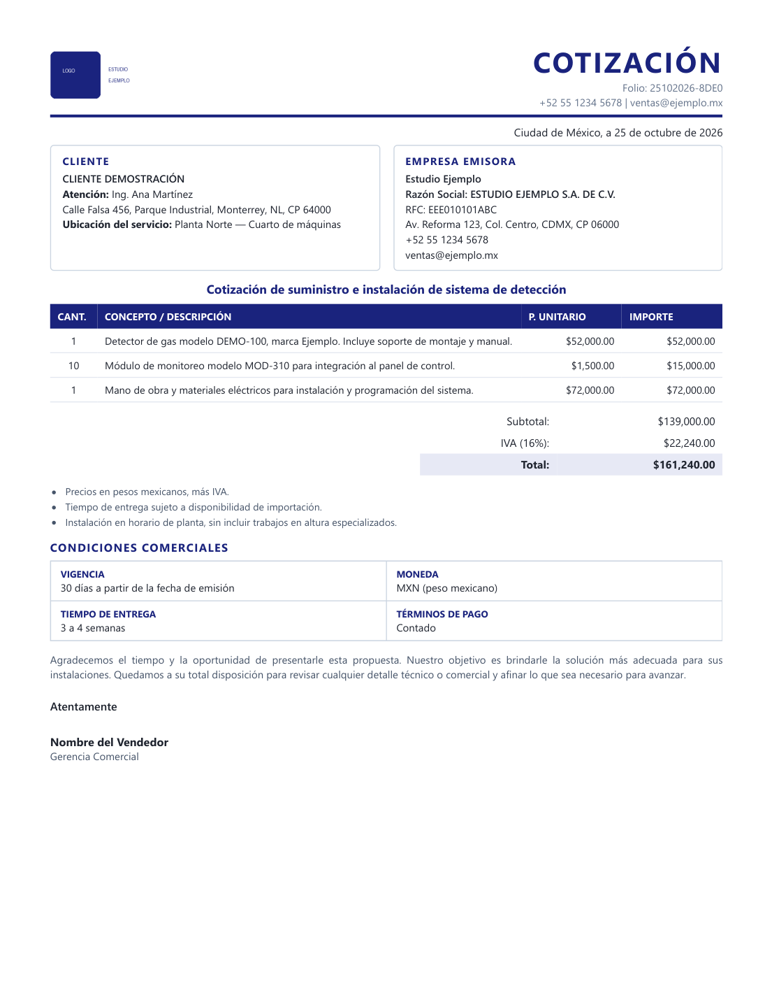

# quote-pdf-generator

**Cotizaciones profesionales en PDF desde Python, sin Word ni LibreOffice.**
El documento se define en JSON; el layout es HTML+CSS; el PDF lo renderiza Chrome headless.

**Professional quote/proposal PDFs from Python — no Word, no LibreOffice.**
JSON in, print-ready PDF out.




<sub>Cotización de ejemplo renderizada a PDF desde un JSON · Example quotation rendered to PDF from a JSON file</sub>

---

## Por qué este enfoque

Generar PDFs "de negocio" en Python tiene tres caminos habituales y todos tienen un costo:

| Enfoque | Problema |
|---|---|
| `python-docx` | Word deforma las tablas, y el resultado depende de la versión de Office instalada |
| ReportLab | Hay que calcular coordenadas. Cambiar un texto implica reposicionar todo |
| **HTML + CSS → PDF** | **Cero coordenadas, cero dependencia de Office.** Lo que ves en el navegador es lo que se imprime |

Este proyecto va por el tercero. La plantilla es CSS: si quieres otro color, otra tipografía o una hoja anexa, lo editas como editarías una página web.

## Características

- **Margen configurable** — si das un costo, el precio de venta se calcula como `costo / (1 - margen)`. Con 30% → `costo / 0.70`
- **Impuesto configurable** — IVA 16% por defecto, pero acepta cualquier tasa y cualquier etiqueta
- **Folio automático** — patrón `DDMMAAAA-XXXX` o el que definas
- **Anexo técnico opcional** — hoja aparte con salto de página, sin pelear con el layout
- **Logo embebido como data URI** — el HTML es autocontenido, funciona sin rutas relativas
- **Multi-moneda y multi-idioma** — los encabezados de tabla y etiquetas son configurables
- **Windows, Linux y macOS** — detecta Chrome o Edge, o usa `BROWSER_BIN`

## Instalación

```bash
git clone https://github.com/TU_USUARIO/quote-pdf-generator.git
cd quote-pdf-generator
# Sin dependencias. Solo necesitas Chrome, Chromium o Edge instalado.
python quote_pdf.py --config examples/quote.example.json --out salida/
```

## Uso

```bash
# Genera PDF y HTML
python quote_pdf.py --config examples/quote.example.json --out salida/

# Solo el HTML (útil para revisar el diseño sin abrir el visor de PDF)
python quote_pdf.py --config examples/quote.example.json --html-only

# Forzar un navegador específico
BROWSER_BIN=/usr/bin/chromium python quote_pdf.py --config mi.json
```

## El archivo de configuración

Todo vive en un JSON. Copia el ejemplo y edítalo.

```jsonc
{
  "brand": {
    "name": "Mi Empresa",
    "legal_name": "MI EMPRESA S.A. DE C.V.",
    "tax_id": "MEE010101ABC",
    "address": "Calle 123, Ciudad, CP 00000",
    "phone": "+52 55 1234 5678",
    "email": "ventas@miempresa.mx",
    "city": "Ciudad de México",
    "logo": "logo.png"
  },
  "client": {
    "name": "CLIENTE S.A.",
    "tax_id": "CDE020202XYZ",
    "address": "Av. Siempre Viva 742",
    "attention": "Ing. Ana Martínez",
    "site": "Planta Norte"
  },
  "title": "Cotización de suministro de equipo",
  "margin": 0.30,
  "tax": { "rate": 0.16, "label": "IVA" },
  "items": [
    { "qty": 1, "description": "Equipo modelo X", "price": 52000.00 },
    { "qty": 10, "description": "Módulo Y", "price": 1500.00 },
    { "qty": 1, "description": "Instalación", "cost": 50400.00 }
  ],
  "conditions": {
    "validity": "30 días",
    "currency": "MXN",
    "delivery": "3 a 4 semanas",
    "payment": "Contado"
  },
  "signer_name": "Nombre del Vendedor",
  "signer_role": "Gerencia Comercial"
}
```

### `price` vs `cost`

- **`price`** → precio de venta unitario. Se usa tal cual.
- **`cost`** → costo interno. Se le aplica el margen: `precio = costo / (1 - margen)`.

Puedes mezclar ambos en la misma cotización. Así el margen nunca se te va de las manos y nunca aparece en el documento — el cliente solo ve el precio de venta.

## Estructura del PDF

1. Encabezado — logo a la izquierda, "COTIZACIÓN" y folio a la derecha, línea de acento
2. Fecha en formato largo
3. Dos bloques — Cliente | Empresa emisora
4. Título del alcance
5. Tabla de partidas (cantidad, descripción, precio unitario, importe)
6. Totales — subtotal, impuesto, total
7. Notas opcionales
8. Condiciones comerciales en cuadrícula 2×2
9. Párrafo de agradecimiento
10. Firma
11. Anexo (opcional, en hoja nueva)

## Personalización

**Colores y tipografía** — en el bloque `style`:

```json
"style": {
  "accent": "#0D47A1",
  "accent_soft": "#E3F2FD",
  "font": "'Helvetica Neue', Arial, sans-serif",
  "page_size": "Letter",
  "page_margin": "15mm 15mm",
  "logo_height": "64px"
}
```

**Etiquetas del documento** — para cotizar en otro idioma o con otra nomenclatura:

```json
"doc_label": "PROPOSAL",
"client_label": "Bill To",
"qty_header": "QTY",
"desc_header": "DESCRIPTION",
"subtotal_label": "Subtotal"
```

**Anexo técnico** — HTML puro, con salto de página automático:

```json
"annex_html": "<h3>Especificaciones</h3><p>Texto libre…</p>"
```

## Notas de operación

- **El truco del PDF temporal.** En Windows, Chrome a veces no puede escribir el PDF en ciertos directorios y falla **en silencio** (`exit 0`, sin archivo). Este script escribe primero en `tempfile.gettempdir()` y luego lo mueve. Si lo modificas, conserva ese paso.
- **Perfil de Chrome propio.** Se usa `--user-data-dir` en un directorio temporal; con el perfil por defecto Chrome falla con `0x3` en algunos equipos.
- **Fuentes.** Si usas una fuente del sistema, tiene que existir en la máquina que renderiza. Para portabilidad total, usa una fuente web o las genéricas (`Segoe UI`, `Arial`, `Helvetica`).
- **Fondos.** `-webkit-print-color-adjust: exact` ya está aplicado vía impresión normal; si los colores de fondo no salen, verifica "Gráficos de fondo" en la configuración de impresión de Chrome.

## Licencia

MIT — ver [LICENSE](LICENSE).

---

## English

Generates business quote PDFs from a JSON definition. The layout is HTML+CSS rendered by headless Chrome, so there are no coordinates to compute and no dependency on Microsoft Office.

- Configurable margin: `price = cost / (1 - margin)`
- Configurable tax rate and label
- Automatic folio (`DDMMAAAA-XXXX` by default)
- Optional technical annex on its own page
- Self-contained HTML (logo embedded as data URI)
- Works on Windows, Linux and macOS — auto-detects Chrome/Edge, or set `BROWSER_BIN`

```bash
python quote_pdf.py --config examples/quote.example.json --out output/
```

```jsonc
{ "brand": {...}, "client": {...}, "title": "...", "margin": 0.30,
  "items": [{ "qty": 1, "description": "Item", "cost": 1000.00 }] }
```
